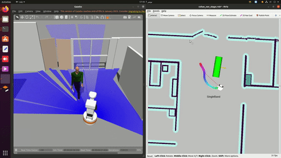
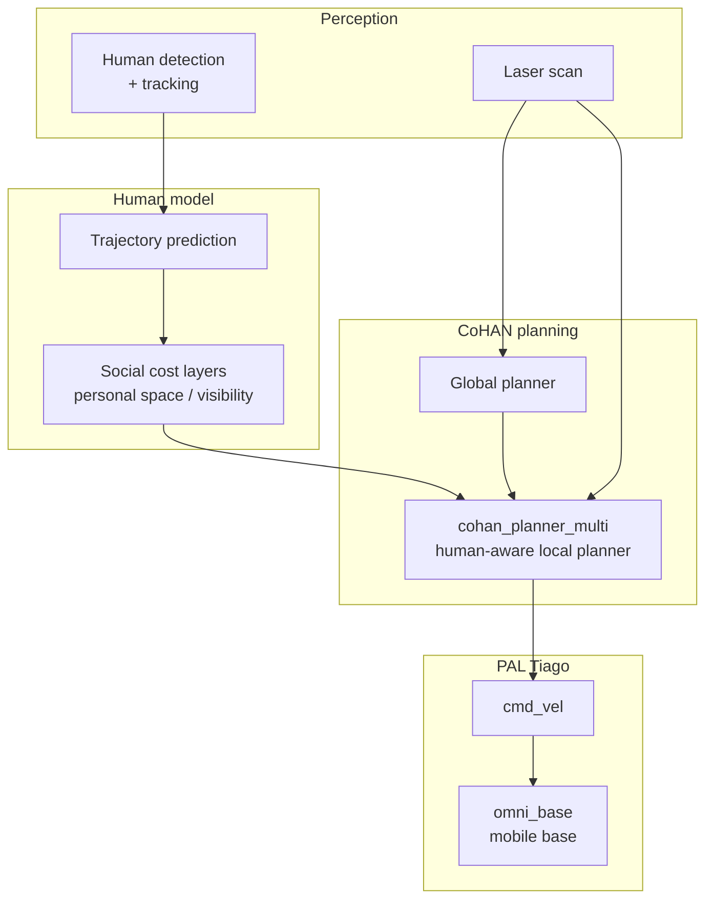

# Human-Aware Navigation — CoHAN on PAL Tiago

Integration project: socially-aware navigation for a **PAL Robotics Tiago**
mobile manipulator using **CoHAN** (Co-operative Human-Aware Navigation), so
the robot plans around people rather than treating them as ordinary obstacles.

▶️ **[Full demo video](https://youtu.be/REPLACE_WITH_YOUR_LINK)**

---

> **Scope note.** This repository documents a **systems integration**, not a
> new planner. CoHAN and the PAL Tiago stack are third-party packages —
> referenced here, not redistributed. The contribution is bringing them up
> together, configuring the human-aware layers, and validating the behaviour
> in simulation.

## Why human-aware navigation is different

A standard local planner treats a person as a moving obstacle: avoid the
current footprint, replan when it moves. That produces behaviour humans read as
rude or unsafe — cutting close, approaching head-on, hovering behind someone.

CoHAN plans in a cost space that encodes **social conventions**: personal space,
passing side, visibility, and predicted human motion rather than just present
position.

## System architecture

## Stack

The workspace brings together a large dependency tree. Principal components:

| component | role |
|---|---|
| `CoHAN_Navigation` | human-aware navigation framework |
| `cohan_planner_multi` | multi-human local planner |
| `navigation_layers` | social costmap layers |
| `omni_base_navigation` / `omni_base_robot` | Tiago mobile base |
| `pal_gazebo_worlds`, `pal_gazebo_plugins` | simulation environment |
| `aruco_ros` | marker-based localisation |
| `openslam_gmapping` | SLAM |

All are upstream packages — see **Dependencies** below.

## Dependencies

Install separately:

- [CoHAN](https://github.com/sphanit/CoHAN_Navigation) — LAAS-CNRS
- [PAL Robotics Tiago stack](https://github.com/pal-robotics) — `pal_*`,
  `omni_base_*`, `tiago_*`
- ROS Noetic + Gazebo

A `.rosinstall` / `vcs` import file is the right way to reproduce the
workspace — the original 566 MB built workspace is deliberately **not**
committed here, since it contained only upstream sources plus `build/` and
`devel/` artifacts.

## Practical notes

**Human detection quality bounds everything.** The planner can only be as
socially aware as its human tracker — missed detections collapse it back to
ordinary obstacle avoidance.

**Social cost tuning is subjective and context-dependent.** Personal-space
radii that feel right in a corridor feel obstructive in an open room. Expect to
retune per environment.

**Simulation flatters it.** Gazebo humans move predictably; real people stop,
turn and change their minds. Treat simulation results as a lower bound on
difficulty.
